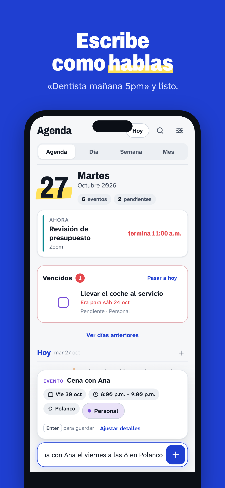

# Ritmo — tu agenda en español

Escribe como hablas («Dentista mañana 5pm») y Ritmo lo acomoda.



## Qué hay aquí

| Carpeta | Contenido |
|---|---|
| `prototipo/` | App web funcional (sin dependencias): `index.html`, `core.js`, `parser.js`, `app.js` |
| `dist/ritmo.html` | La misma app en un solo archivo: ábrelo con doble clic |
| `imagenes/` | Capturas de la app, imágenes de tienda, ícono 1024 y gráfico de Google Play |
| `docs/PROMPTS.md` | Prompts listos para construir la app nativa por fases y para diseño e imágenes |
| `docs/PLAN.md` | Logística: fases, costos, stack, lo que se necesita de ti, tienda y privacidad |
| `docs/ESPECIFICACION.md` | Pantallas, modelo de datos, reglas del intérprete y diseño |
| `pruebas/` | Pruebas automáticas del intérprete y del núcleo |
| `herramientas/` | Scripts para empaquetar y regenerar las imágenes |

## Comandos

```bash
node --test ritmo/pruebas/                 # pruebas
node ritmo/herramientas/empaquetar.mjs     # genera dist/ritmo.html
node ritmo/herramientas/capturas.mjs       # regenera imagenes/ (requiere Playwright)
```

## Ritmo Belleza: PWA y backend

La app del salón cuenta con versión instalable, archivos para usarla sin conexión y backend Node + TypeScript con PostgreSQL. Consulta [publicación e instalación en iPhone](docs/DESPLIEGUE.md) para las variables de Railway, los comandos locales y la sincronización.

[Abre la aplicación publicada](https://belleza-production.up.railway.app) y consulta [el manual de uso](docs/USO.md). El despliegue está dentro del límite de consumo de Railway autorizado por Antonio: 10 USD compartidos por ciclo, sin ampliarlo. WhatsApp oficial está preparado en modo gratuito y pendiente de vincular el número del salón. Los archivos de publicación están en `dist/pwa/`; `dist/belleza.html` sigue siendo la descarga de un solo archivo.
